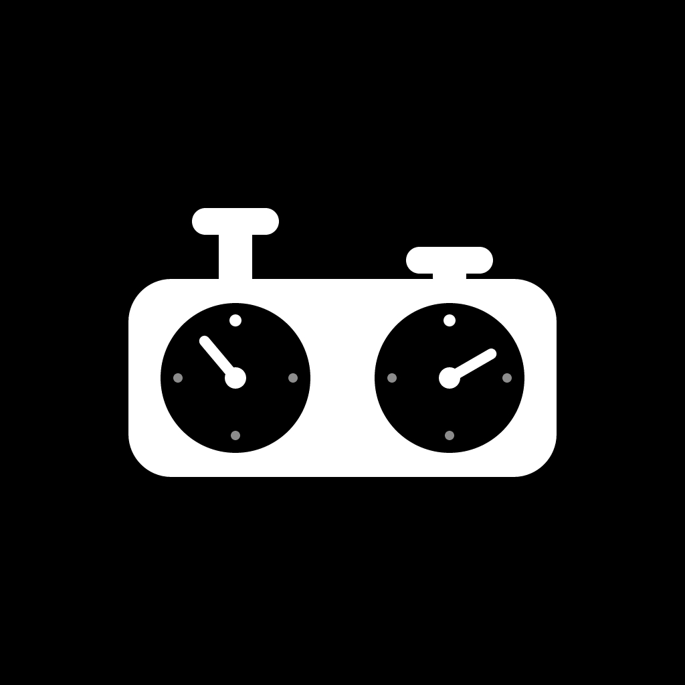

<p align="center">
  
</p>

<h1 align="center">ClockMate</h1>

<p align="center">A simple, distraction-free chess clock for over-the-board play.</p>

---

## Features

- **Two-player clock**: each player gets half the screen. The top half is rotated so the player across the board can read it.
- **Tap to switch turns**: tap your side to stop your clock and start your opponent's.
- **Presets**: Bullet, Blitz, Rapid and Classical time controls.
- **Custom time controls**: set minutes, seconds and an increment per move.
- **Increment support**: the increment is added to your clock each time you end your turn.
- **Pause, resume and reset** at any time.
- **Haptic feedback** on every tap.
- **Dark, high-contrast UI**: the player whose clock is running gets the white side, so you can see whose turn it is from across the table.

## Tech stack

- [Expo](https://expo.dev) SDK 54 / React Native 0.81 (New Architecture)
- TypeScript
- `expo-haptics`, `expo-font`, `expo-splash-screen`
- `lucide-react-native` + `react-native-svg` for icons

No navigation library: the app has one screen, and the time-control picker opens in a React Native `Modal`.

## Getting started

**Requirements:** Node 20+ and npm. To run native builds, you also need Android Studio (Android) or Xcode (iOS).

```bash
npm install

# Start the dev server
npm start

# Build and run on a device / emulator
npm run android
npm run ios

# Run in the browser
npm run web
```

> Use **npm**, not yarn. CI installs with `npm ci`, so `package-lock.json` is the only lockfile.

## Project structure

```
index.ts            Entry point (registerRootComponent)
App.tsx             Root: fonts, splash screen, providers, setup modal
screens/
  ClockScreen.tsx   The two-player clock
  SetupScreen.tsx   Time control picker (presets + custom)
contexts/           ClockProvider: timer, turns, increment, game state
hooks/              useClock()
components/ui/      Button, IconButton, Chip, NumberField, Text, TimeControlButton
constants/          Colors, typography/spacing theme, categories, time values
definitions/        Shared types (Player, TimeControl)
enums/              GameStates, Categories
utils/time.ts       Time formatting helpers
assets/             Icon, splash, fonts (Poppins Medium + SemiBold)
```

All clock logic lives in `contexts/ClockProvider.tsx`. Screens read it through the `useClock()` hook.

## Building and releasing

Builds run on [EAS Build](https://docs.expo.dev/build/introduction/). The profiles are in `eas.json`:

| Profile       | Output | Use                                  |
| ------------- | ------ | ------------------------------------ |
| `development` | APK    | Dev client for local development     |
| `preview`     | APK    | Internal testing / GitHub releases   |
| `production`  | AAB    | Google Play Store (auto-increments the build number) |

```bash
eas build --platform android --profile production
```

### GitHub release workflow

`.github/workflows/release.yml` builds a `preview` APK on EAS and attaches it to a GitHub release. It runs when you push a `v*` tag:

```bash
git tag v1.1.0
git push origin v1.1.0
```

It can also be started manually from the Actions tab. That builds the APK but doesn't create a release. It needs an `EXPO_TOKEN` repository secret.

### App size

The release build is set up to stay small:

- `expo-build-properties` builds Android for `arm64-v8a` and `armeabi-v7a` only, with R8 minify, resource shrinking and compressed native libraries.
- Lucide icons are imported one by one (`lucide-react-native/icons/<name>`). Importing from the package root bundles every icon.
- Only the two font weights the app uses are included.

R8 can remove code the app still needs, and that only shows up in release builds. Test a release build before publishing.

## Updating the app icon

The icon source is `assets/images/icon.svg`. If you change it, re-export these PNGs:

- `icon.png`: 1024×1024, opaque (iOS rejects icons with transparency)
- `adaptive-icon.png`: 1024×1024, transparent, artwork scaled to about 74% so Android's icon masks don't crop it
- `splash-icon.png`: transparent
- `favicon.png`: 196×196
